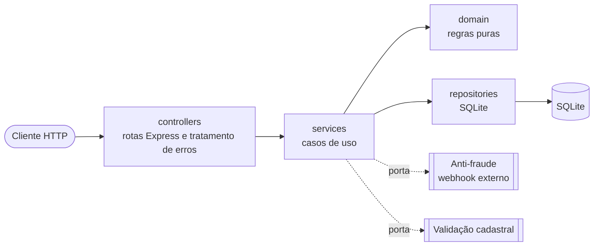

# Relatório Técnico: Wallet API

**Projeto Capstone:** API de microsserviço financeiro com automação de CI, suíte de self-testing multinível e estratégia de branching
**Autora:** Franthesca Assis Pereira (UniEVANGÉLICA)

## 1. Visão geral

A Wallet API é um microsserviço REST simplificado de carteira digital e conciliação bancária. Ela permite abrir contas com saldo inicial, transferir saldo entre contas, consultar o extrato e notificar um serviço externo (fictício) de anti-fraude a cada transferência.

O foco do projeto não é a quantidade de funcionalidades, e sim a forma de construir: regras de negócio escritas com TDD, testes em três níveis, dependências externas isoladas com test doubles e um pipeline que impede a entrada de código sem validação.

## 2. Especificação de Requisitos (SRS)

### 2.1 Requisitos funcionais

| ID | Requisito | Critério de aceitação |
|---|---|---|
| RF01 | Criar conta digital com nome do titular, CPF e saldo inicial. | `POST /accounts` responde 201 com o identificador da conta e o saldo informado. Saldo inicial negativo ou não inteiro é recusado com 400. |
| RF02 | Validar a situação cadastral do titular antes de abrir a conta. | CPF com situação irregular no serviço de validação cadastral é recusado com 422 e nenhuma conta é criada. |
| RF03 | Impedir mais de uma conta para o mesmo CPF. | Segunda tentativa com o mesmo CPF responde 409. |
| RF04 | Consultar uma conta pelo identificador. | `GET /accounts/{id}` responde 200 com titular e saldo atual, ou 404 se a conta não existir. |
| RF05 | Transferir saldo entre duas contas. | `POST /transfers` debita a origem e credita o destino pelo mesmo valor e responde 201. |
| RF06 | Recusar transferência sem saldo suficiente. | Resposta 422 e os saldos das duas contas permanecem inalterados. |
| RF07 | Garantir idempotência das transferências. | Repetir a requisição com a mesma `Idempotency-Key` devolve a transferência original (200) sem novo débito. A mesma chave com dados diferentes responde 409. |
| RF08 | Manter a consistência sob concorrência. | Transferências simultâneas sobre a mesma conta nunca geram saldo negativo nem alteram a soma total dos saldos. |
| RF09 | Registrar lançamentos de débito e crédito. | Cada transferência gera um débito na origem e um crédito no destino. O saldo inicial gera um crédito de abertura. |
| RF10 | Consultar o extrato de uma conta. | `GET /accounts/{id}/statement` lista os lançamentos em ordem cronológica com o saldo após cada um. |
| RF11 | Filtrar o extrato por período e por tipo. | Parâmetros `from`, `to` (AAAA-MM-DD) e `type` (`debit` ou `credit`) restringem os lançamentos. Filtros inválidos respondem 400. |
| RF12 | Notificar o serviço de anti-fraude. | Toda transferência concluída envia um webhook com identificador, contas, valor e data. Requisições repetidas (idempotentes) não geram nova notificação. |
| RF13 | Padronizar erros. | Toda resposta de erro tem o formato `{ "error": { "code", "message" } }`. |
| RF14 | Informar a saúde do serviço. | `GET /health` responde 200. |

### 2.2 Regras de negócio

| ID | Regra |
|---|---|
| RN01 | Valores monetários são números inteiros em centavos (R$ 10,50 = `1050`). |
| RN02 | O valor de uma transferência deve ser maior que zero. |
| RN03 | Conta de origem e conta de destino devem ser diferentes. |
| RN04 | O saldo de uma conta nunca pode ficar negativo. |
| RN05 | O CPF deve ter 11 dígitos e dígitos verificadores válidos. |
| RN06 | A soma dos lançamentos de uma conta (créditos menos débitos) deve ser igual ao seu saldo (conciliação). |

### 2.3 Requisitos não funcionais

| ID | Categoria | Requisito |
|---|---|---|
| RNF01 | Precisão | Nenhum cálculo financeiro usa ponto flutuante: todos os valores trafegam e são armazenados em centavos inteiros. |
| RNF02 | Integridade | Débito, crédito, lançamentos e registro de idempotência de uma transferência ocorrem em uma única transação: ou tudo é gravado, ou nada é. |
| RNF03 | Testabilidade | Serviços externos (anti-fraude e validação cadastral), relógio e gerador de identificadores são injetados por construtor, o que permite substituí-los por test doubles. |
| RNF04 | Qualidade | A suíte de testes deve cobrir no mínimo 80% dos branches e 85% das linhas e statements, com verificação automática no pipeline. |
| RNF05 | Qualidade | Código com erro de lint ou teste quebrado não pode ser integrado à `main`. |
| RNF06 | Desempenho | Com 50 usuários simultâneos no endpoint de transferência, a taxa de erro deve ficar abaixo de 1% e a latência média abaixo de 500 ms. |
| RNF07 | Resiliência | A indisponibilidade ou lentidão do anti-fraude não pode impedir nem desfazer uma transferência já efetivada. |
| RNF08 | Configuração | Porta, banco de dados e endereço do anti-fraude são definidos por variáveis de ambiente (`.env`), sem segredos versionados. |
| RNF09 | Portabilidade | O projeto roda com Node.js 22 e os scripts do `package.json`, sem serviços externos obrigatórios. |
| RNF10 | Rastreabilidade | O histórico do Git segue Conventional Commits e toda mudança chega à `main` por pull request. |

### 2.4 Contrato da API

| Método | Rota | Descrição | Respostas |
|---|---|---|---|
| `GET` | `/health` | Saúde do serviço | 200 |
| `POST` | `/accounts` | Cria conta (`ownerName`, `document`, `initialBalance`) | 201, 400, 409, 422 |
| `GET` | `/accounts/{id}` | Consulta conta e saldo | 200, 404 |
| `POST` | `/transfers` | Transfere saldo (`sourceAccountId`, `targetAccountId`, `amount`) com o cabeçalho `Idempotency-Key` | 201, 200 (repetição), 400, 404, 409, 422 |
| `GET` | `/accounts/{id}/statement` | Extrato com filtros `from`, `to` e `type` | 200, 400, 404 |

## 3. Arquitetura

A aplicação segue uma arquitetura em camadas, com as dependências apontando sempre para dentro (controllers → services → domain; services → repositories).



| Camada | Pasta | Responsabilidade |
|---|---|---|
| Domínio | `src/domain` | Regras puras, sem banco nem HTTP: validação de valores, cálculo da transferência, validação de CPF, filtros do extrato e erros de negócio. É onde o TDD unitário se concentra. |
| Serviços | `src/services` | Casos de uso (abrir conta, transferir, emitir extrato) e clientes dos serviços externos. |
| Repositórios | `src/repositories` | Acesso ao SQLite e controle de transação. |
| Controllers | `src/controllers` | Rotas HTTP, conversão de requisição e resposta e mapeamento de erros para status HTTP. |

### 3.1 Decisões de arquitetura

| Decisão | Motivo |
|---|---|
| Valores em centavos inteiros | Evita erros de arredondamento de ponto flutuante em operações financeiras (RNF01). |
| SQLite (`better-sqlite3`) | Banco relacional com transações reais, que roda em memória nos testes e em arquivo fora deles, sem infraestrutura adicional. |
| Transferência dentro de uma transação imediata | A leitura dos saldos, o cálculo e a gravação acontecem de forma atômica e serializada, o que impede que duas transferências simultâneas leiam o mesmo saldo (RF08, RNF02). Uma restrição `CHECK (balance >= 0)` no banco funciona como última barreira. |
| Idempotência por `Idempotency-Key` | A chave é gravada na mesma transação da transferência, junto com uma impressão digital dos dados. Repetições devolvem o resultado original (RF07). |
| Injeção de dependências por construtor | Permite trocar anti-fraude, validação cadastral, relógio e gerador de ids por mocks e stubs (RNF03). |
| Notificação ao anti-fraude após o commit | A notificação é um efeito colateral externo e não deve segurar a transação nem desfazê-la (RNF07). |

## 4. Estratégia de branching

O repositório adota **Trunk-Based Development**.

- A `main` é o tronco único e deve estar sempre íntegra (lint e testes verdes).
- Toda mudança nasce em uma branch curta, criada a partir da `main`, com um único objetivo e vida inferior a um dia.
- A integração acontece somente por **pull request**, com o pipeline de CI como verificação obrigatória. Não há commits diretos na `main`.
- Como o trabalho é individual, a revisão de cada pull request é uma autorrevisão guiada pelo checklist do modelo de PR (`.github/pull_request_template.md`), somada à validação automática do CI.
- Correções emergenciais usam branches `hotfix/*`, criadas a partir da `main`, com um teste de regressão escrito antes da correção.
- Os merges são feitos com *merge commit*, para que cada branch fique visível no histórico.

### 4.1 Convenções

| Item | Convenção |
|---|---|
| Nome de branch | `tipo/descricao-curta`, com os tipos `feat`, `fix`, `hotfix`, `test`, `ci`, `docs` e `chore` |
| Mensagem de commit | [Conventional Commits](https://www.conventionalcommits.org/pt-br/): `tipo(escopo opcional): descrição no imperativo` |
| Ciclo TDD | O sufixo `(RED)`, `(GREEN)` ou `(REFACTOR)` identifica a etapa do ciclo em cada commit |

Exemplo de ciclo no histórico:

```text
test: especifica a regra de saldo insuficiente (RED)
feat: implementa a regra de saldo insuficiente (GREEN)
refactor: extrai a validação de valor monetário (REFACTOR)
```
