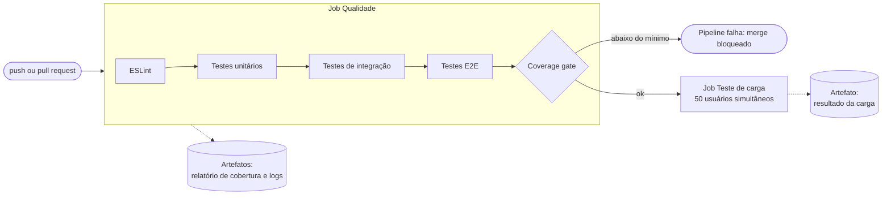

# Relatório Técnico: Wallet API

**Projeto Capstone:** API de microsserviço financeiro com automação de CI, suíte de self-testing multinível e estratégia de branching
**Autora:** Franthesca Assis Pereira (UniEVANGÉLICA)

## 1. Visão geral

A Wallet API é um microsserviço REST simplificado de carteira digital e conciliação bancária. Ela permite abrir contas com saldo inicial, transferir saldo entre contas, consultar o extrato e notificar um serviço externo (fictício) de anti-fraude a cada transferência.

O foco do projeto não é a quantidade de funcionalidades, e sim a forma de construir: regras de negócio escritas com TDD, testes em três níveis, dependências externas isoladas com test doubles e um pipeline que impede a entrada de código sem validação.

## 2. Especificação de Requisitos (SRS)

### 2.1 Requisitos funcionais

| ID | Requisito | Critério de aceitação |
|---|---|---|
| RF01 | Criar conta digital com nome do titular, CPF e saldo inicial. | `POST /accounts` responde 201 com o identificador da conta e o saldo informado. Saldo inicial negativo ou não inteiro é recusado com 400. |
| RF02 | Validar a situação cadastral do titular antes de abrir a conta. | CPF com situação irregular no serviço de validação cadastral é recusado com 422 e nenhuma conta é criada. |
| RF03 | Impedir mais de uma conta para o mesmo CPF. | Segunda tentativa com o mesmo CPF responde 409. |
| RF04 | Consultar uma conta pelo identificador. | `GET /accounts/{id}` responde 200 com titular e saldo atual, ou 404 se a conta não existir. |
| RF05 | Transferir saldo entre duas contas. | `POST /transfers` debita a origem e credita o destino pelo mesmo valor e responde 201. |
| RF06 | Recusar transferência sem saldo suficiente. | Resposta 422 e os saldos das duas contas permanecem inalterados. |
| RF07 | Garantir idempotência das transferências. | Repetir a requisição com a mesma `Idempotency-Key` devolve a transferência original (200) sem novo débito. A mesma chave com dados diferentes responde 409. |
| RF08 | Manter a consistência sob concorrência. | Transferências simultâneas sobre a mesma conta nunca geram saldo negativo nem alteram a soma total dos saldos. |
| RF09 | Registrar lançamentos de débito e crédito. | Cada transferência gera um débito na origem e um crédito no destino. O saldo inicial gera um crédito de abertura. |
| RF10 | Consultar o extrato de uma conta. | `GET /accounts/{id}/statement` lista os lançamentos em ordem cronológica com o saldo após cada um. |
| RF11 | Filtrar o extrato por período e por tipo. | Parâmetros `from`, `to` (AAAA-MM-DD) e `type` (`debit` ou `credit`) restringem os lançamentos. Filtros inválidos respondem 400. |
| RF12 | Notificar o serviço de anti-fraude. | Toda transferência concluída envia um webhook com identificador, contas, valor e data. Requisições repetidas (idempotentes) não geram nova notificação. |
| RF13 | Padronizar erros. | Toda resposta de erro tem o formato `{ "error": { "code", "message" } }`. |
| RF14 | Informar a saúde do serviço. | `GET /health` responde 200. |

### 2.2 Regras de negócio

| ID | Regra |
|---|---|
| RN01 | Valores monetários são números inteiros em centavos (R$ 10,50 = `1050`). |
| RN02 | O valor de uma transferência deve ser maior que zero. |
| RN03 | Conta de origem e conta de destino devem ser diferentes. |
| RN04 | O saldo de uma conta nunca pode ficar negativo. |
| RN05 | O CPF deve ter 11 dígitos e dígitos verificadores válidos. |
| RN06 | A soma dos lançamentos de uma conta (créditos menos débitos) deve ser igual ao seu saldo (conciliação). |

### 2.3 Requisitos não funcionais

| ID | Categoria | Requisito |
|---|---|---|
| RNF01 | Precisão | Nenhum cálculo financeiro usa ponto flutuante: todos os valores trafegam e são armazenados em centavos inteiros. |
| RNF02 | Integridade | Débito, crédito, lançamentos e registro de idempotência de uma transferência ocorrem em uma única transação: ou tudo é gravado, ou nada é. |
| RNF03 | Testabilidade | Serviços externos (anti-fraude e validação cadastral), relógio e gerador de identificadores são injetados por construtor, o que permite substituí-los por test doubles. |
| RNF04 | Qualidade | A suíte de testes deve cobrir no mínimo 80% dos branches e 85% das linhas e statements, com verificação automática no pipeline. |
| RNF05 | Qualidade | Código com erro de lint ou teste quebrado não pode ser integrado à `main`. |
| RNF06 | Desempenho | Com 50 usuários simultâneos no endpoint de transferência, a taxa de erro deve ficar abaixo de 1% e a latência média abaixo de 500 ms. |
| RNF07 | Resiliência | A indisponibilidade ou lentidão do anti-fraude não pode impedir nem desfazer uma transferência já efetivada. |
| RNF08 | Configuração | Porta, banco de dados e endereço do anti-fraude são definidos por variáveis de ambiente (`.env`), sem segredos versionados. |
| RNF09 | Portabilidade | O projeto roda com Node.js 22 e os scripts do `package.json`, sem serviços externos obrigatórios. |
| RNF10 | Rastreabilidade | O histórico do Git segue Conventional Commits e toda mudança chega à `main` por pull request. |

### 2.4 Contrato da API

| Método | Rota | Descrição | Respostas |
|---|---|---|---|
| `GET` | `/health` | Saúde do serviço | 200 |
| `POST` | `/accounts` | Cria conta (`ownerName`, `document`, `initialBalance`) | 201, 400, 409, 422 |
| `GET` | `/accounts/{id}` | Consulta conta e saldo | 200, 404 |
| `POST` | `/transfers` | Transfere saldo (`sourceAccountId`, `targetAccountId`, `amount`) com o cabeçalho `Idempotency-Key` | 201, 200 (repetição), 400, 404, 409, 422 |
| `GET` | `/accounts/{id}/statement` | Extrato com filtros `from`, `to` e `type` | 200, 400, 404 |

## 3. Arquitetura

A aplicação segue uma arquitetura em camadas, com as dependências apontando sempre para dentro (controllers → services → domain; services → repositories).


| Camada | Pasta | Responsabilidade |
|---|---|---|
| Domínio | `src/domain` | Regras puras, sem banco nem HTTP: validação de valores, cálculo da transferência, validação de CPF, filtros do extrato e erros de negócio. É onde o TDD unitário se concentra. |
| Serviços | `src/services` | Casos de uso (abrir conta, transferir, emitir extrato) e clientes dos serviços externos. |
| Repositórios | `src/repositories` | Acesso ao SQLite e controle de transação. |
| Controllers | `src/controllers` | Rotas HTTP, conversão de requisição e resposta e mapeamento de erros para status HTTP. |

### 3.1 Decisões de arquitetura

| Decisão | Motivo |
|---|---|
| Valores em centavos inteiros | Evita erros de arredondamento de ponto flutuante em operações financeiras (RNF01). |
| SQLite (`better-sqlite3`) | Banco relacional com transações reais, que roda em memória nos testes e em arquivo fora deles, sem infraestrutura adicional. |
| Transferência dentro de uma transação imediata | A leitura dos saldos, o cálculo e a gravação acontecem de forma atômica e serializada, o que impede que duas transferências simultâneas leiam o mesmo saldo (RF08, RNF02). Uma restrição `CHECK (balance >= 0)` no banco funciona como última barreira. |
| Idempotência por `Idempotency-Key` | A chave é gravada na mesma transação da transferência, junto com uma impressão digital dos dados. Repetições devolvem o resultado original (RF07). |
| Injeção de dependências por construtor | Permite trocar anti-fraude, validação cadastral, relógio e gerador de ids por mocks e stubs (RNF03). |
| Notificação ao anti-fraude após o commit | A notificação é um efeito colateral externo e não deve segurar a transação nem desfazê-la (RNF07). |

## 4. Estratégia de branching

O repositório adota **Trunk-Based Development**.

- A `main` é o tronco único e deve estar sempre íntegra (lint e testes verdes).
- Toda mudança nasce em uma branch curta, criada a partir da `main`, com um único objetivo e vida inferior a um dia.
- A integração acontece somente por **pull request**, com o pipeline de CI como verificação obrigatória. Não há commits diretos na `main`.
- Como o trabalho é individual, a revisão de cada pull request é uma autorrevisão guiada pelo checklist incluído na descrição de cada pull request, somada à validação automática do CI.
- Correções emergenciais usam branches `hotfix/*`, criadas a partir da `main`, com um teste de regressão escrito antes da correção.
- Os merges são feitos com *merge commit*, para que cada branch fique visível no histórico.

### 4.1 Convenções

| Item | Convenção |
|---|---|
| Nome de branch | `tipo/descricao-curta`, com os tipos `feat`, `fix`, `hotfix`, `test`, `ci`, `docs` e `chore` |
| Mensagem de commit | [Conventional Commits](https://www.conventionalcommits.org/pt-br/): `tipo(escopo opcional): descrição no imperativo` |
| Ciclo TDD | O sufixo `(RED)`, `(GREEN)` ou `(REFACTOR)` identifica a etapa do ciclo em cada commit |

Exemplo de ciclo no histórico:

```text
test: especifica a regra de saldo insuficiente (RED)
feat: implementa a regra de saldo insuficiente (GREEN)
refactor: extrai a validação de valor monetário (REFACTOR)
```

## 5. Estratégia de testes

### 5.1 Pirâmide de testes

A suíte tem 231 testes automatizados, distribuídos em três níveis. A base larga de testes unitários e o topo estreito de E2E mantêm a execução completa em poucos segundos.

| Nível | Pasta | Testes | O que valida | Dependências |
|---|---|---|---|---|
| Unitário | `tests/unit` | 135 | Regras puras de domínio (valores, transferência, CPF, filtros, idempotência), mapeamento de erros HTTP, configuração e cliente do webhook | Nenhuma: sem banco e sem rede |
| Integração | `tests/integration` | 74 | Serviços e repositórios trabalhando juntos: abertura de conta, transferência, idempotência, concorrência, extrato e transações | SQLite em memória, mocks e stubs |
| E2E | `tests/e2e` | 22 | Fluxo completo por HTTP: registro de contas, transferência, extrato final, webhook e respostas de erro | API em uma porta real, SQLite em memória e um servidor HTTP local no papel do anti-fraude |

Cada nível é um *project* do Jest (`jest.config.js`) e pode ser executado isoladamente com `npm run test:unit`, `npm run test:integration` e `npm run test:e2e`.

### 5.2 TDD e ciclo Red-Green-Refactor

As regras de negócio foram escritas com o teste antes do código. O histórico registra cada etapa em um commit separado, identificado pelo sufixo `(RED)`, `(GREEN)` ou `(REFACTOR)`:

- **RED:** o commit contém apenas o teste, que falha porque o comportamento ainda não existe.
- **GREEN:** o commit seguinte contém o código mínimo que faz o teste passar.
- **REFACTOR:** quando há duplicação, um terceiro commit melhora o código sem alterar os testes.

O histórico tem 16 ciclos RED → GREEN, 4 deles com etapa de REFACTOR. Para listá-los:

```bash
git log --reverse --oneline --grep="(RED)" --grep="(GREEN)" --grep="(REFACTOR)"
```

| Ciclo | Commit RED (teste) | Commit GREEN (código) | REFACTOR |
|---|---|---|---|
| Valores monetários | `test(domain): especifica a validação de valores monetários em centavos` | `feat(domain): valida e formata valores monetários em centavos` | `refactor(domain): extrai verificações comuns de centavos e limite` |
| Regras de transferência | `test(domain): especifica o cálculo e a validação de transferências` | `feat(domain): implementa o cálculo e a validação de transferências` | `refactor(domain): extrai a validação de identificador de conta` |
| CPF | `test(domain): especifica a validação de CPF` | `feat(domain): implementa a validação de CPF pelos dígitos verificadores` | |
| Filtros do extrato | `test(domain): especifica os filtros de período e tipo do extrato` | `feat(domain): implementa os filtros de período e tipo do extrato` | |
| Idempotência (domínio) | `test(domain): especifica a chave e a impressão digital de idempotência` | `feat(domain): implementa a chave e a impressão digital de idempotência` | |
| Contas | `test(accounts): especifica a abertura e a consulta de contas com SQLite em memória` | `feat(accounts): implementa abertura e consulta de contas com persistência em SQLite` | |
| Transferência | `test(transfers): especifica a transferência entre contas com mock do anti-fraude` | `feat(transfers): implementa a transferência atômica com notificação ao anti-fraude` | `refactor(transfers): extrai a busca de conta e o registro de lançamentos` |
| Idempotência (serviço) | `test(transfers): especifica a idempotência das transferências` | `feat(transfers): implementa a idempotência por Idempotency-Key` | |
| Webhook anti-fraude | `test(services): especifica o cliente HTTP do webhook de anti-fraude` | `feat(services): implementa o cliente HTTP do webhook de anti-fraude` | |
| Extrato | `test(statement): especifica o extrato com filtros por período e tipo` | `feat(statement): implementa o extrato com filtros por período e tipo` | |
| API REST | `test(e2e): especifica o fluxo de contas, transferência e extrato por HTTP` | `feat(http): expõe contas, transferências e extrato pela API REST` | |
| Hotfix do anti-fraude | `test(transfers): reproduz o erro 500 quando o anti-fraude está indisponível` | `fix(transfers): conclui a transferência mesmo com o anti-fraude indisponível` | `refactor(transfers): simplifica o retorno após a notificação ao anti-fraude` |
| Hotfix do extrato | `test(statement): reproduz a exclusão dos lançamentos do último dia do período` | `fix(statement): inclui o último dia do período no filtro do extrato` | |

Os demais ciclos (configuração, validador cadastral e mapeamento de erros HTTP) seguem o mesmo padrão.

### 5.3 Test doubles: mocks e stubs

Os dois tipos de dublê têm papéis diferentes no projeto e ficam documentados em `tests/support/test-doubles.js`.

| | Stub | Mock |
|---|---|---|
| Finalidade | Alimentar o teste com **dados de entrada controlados** | Verificar a **interação de saída** com um colaborador |
| O teste verifica o dublê? | Não. Verifica o resultado produzido pelo sistema | Sim. Verifica quantas vezes foi chamado e com quais parâmetros |
| Uso no projeto | Validação cadastral e relógio | Anti-fraude e `fetch` |

**Stubs (dados fixos de entrada)**

| Stub | Dado fixo que fornece | Onde é usado |
|---|---|---|
| `createRegistryValidatorStub('REGULAR')` | Situação cadastral regular para qualquer CPF | `tests/integration/account-service.test.js` e contexto dos testes de integração |
| `createRegistryValidatorStub('IRREGULAR')` | Situação cadastral irregular | Teste "recusa a abertura quando o stub informa situação cadastral irregular" |
| `createFixedClock(...)` | Data e hora definidas pelo teste | Testes de extrato, que posicionam lançamentos em datas conhecidas |

Exemplo: o teste não pergunta nada ao stub, apenas confere o efeito no sistema.

```js
const service = buildService(createRegistryValidatorStub('IRREGULAR'));

await expect(service.createAccount({ ownerName: 'Ana Souza', document: VALID_CPF, initialBalance: 1000 }))
  .rejects.toThrow(DocumentRejectedError);
expect(accountRepository.findByDocument('52998224725')).toBeNull();
```

**Mocks (verificação de chamadas, contagem e parâmetros)**

| Mock | O que o teste verifica | Onde é usado |
|---|---|---|
| `createFraudGatewayMock()` (`jest.fn`) | Uma chamada por transferência concluída, com identificador, contas, valor e data; nenhuma chamada em transferência recusada ou repetida; ordem das chamadas | `tests/integration/transfer-service.test.js`, `transfer-concurrency.test.js` e `container.test.js` |
| Mock de `fetch` | URL, método, cabeçalhos, corpo JSON e sinal de tempo limite do webhook | `tests/unit/fraud-gateway.test.js` |
| Mock de `logger` | Registro da falha de notificação com o identificador da transferência | Testes do hotfix do anti-fraude |

Exemplo: o teste verifica contagem e parâmetros enviados ao serviço externo.

```js
const { transfer } = await context.transferService.transfer(transferRequest({ amount: 4500 }));

expect(context.fraudGateway.notifyTransfer).toHaveBeenCalledTimes(1);
expect(context.fraudGateway.notifyTransfer).toHaveBeenCalledWith({
  transferId: transfer.id,
  sourceAccountId: ana.id,
  targetAccountId: bruno.id,
  amount: 4500,
  occurredAt: '2026-11-12T09:30:00.000Z',
});
```

Nos testes E2E não há mock nem stub dentro da aplicação: o anti-fraude é um servidor HTTP local (`tests/support/fake-antifraud-server.js`) que recebe o webhook de verdade.

### 5.4 Banco de dados em memória

Os testes de integração e E2E usam SQLite em memória (`createDatabase(':memory:')`). Cada teste abre uma conexão nova, o que garante isolamento total, e o banco executa o mesmo esquema, as mesmas restrições (`CHECK`, `UNIQUE`, chaves estrangeiras) e as mesmas transações do modo em arquivo.

### 5.5 Cobertura de código

Medição feita pelo Istanbul (relatório de cobertura do Jest) com `npm run test:coverage`:

| Métrica | Cobertura | Mínimo exigido |
|---|---|---|
| Statements | 99,69% (330/331) | 85% |
| Branches | 98,73% (156/158) | 80% |
| Funções | 100% (84/84) | 85% |
| Linhas | 99,69% (328/329) | 85% |

O arquivo `src/server.js` fica fora da medição por ser apenas o ponto de entrada que abre a porta HTTP. Todo o restante de `src/` é medido.

### 5.6 Rastreabilidade entre requisitos e testes

| Requisito | Testes que o verificam |
|---|---|
| RF01, RF04 | `integration/account-service.test.js`, `e2e/wallet-flow.test.js` |
| RF02 | `integration/account-service.test.js` (stub), `unit/registry-validator.test.js`, `unit/cpf.test.js`, E2E (422) |
| RF03 | `integration/account-service.test.js`, `integration/database.test.js`, E2E (409) |
| RF05, RF06 | `unit/transfer.test.js`, `integration/transfer-service.test.js`, E2E |
| RF07 | `unit/idempotency.test.js`, `integration/transfer-service.test.js`, E2E, teste de carga |
| RF08 | `integration/transfer-concurrency.test.js`, teste de carga |
| RF09 | `integration/account-service.test.js`, `integration/transfer-service.test.js` |
| RF10, RF11 | `unit/statement-filters.test.js`, `integration/statement-service.test.js`, E2E |
| RF12 | `integration/transfer-service.test.js` (mock), `unit/fraud-gateway.test.js`, E2E (webhook real) |
| RF13 | `unit/error-handler.test.js`, E2E |
| RF14 | E2E |
| RNF02 | `integration/database.test.js`, `integration/transfer-service.test.js` (atomicidade) |
| RNF06 | `load/locustfile.py` |
| RNF07 | `integration/transfer-service.test.js` (anti-fraude indisponível), E2E (resiliência) |

## 6. Pipeline de integração contínua

O pipeline está em `.github/workflows/ci.yml` e dispara em todo `push` e `pull_request` para a `main`.



| Etapa | O que faz | O que acontece se falhar |
|---|---|---|
| Análise estática | `npm run lint` (ESLint) | O job falha |
| Testes unitários, de integração e E2E | Um passo por nível, com o log de cada um gravado em arquivo | O job falha |
| Coverage gate | `npm run test:coverage` com os limites do `jest.config.js` | O Jest termina com erro quando a cobertura fica abaixo de 80% de branches ou 85% de linhas, statements e funções |
| Artefatos | Publica `relatorio-de-cobertura` (HTML e LCOV) e `logs-do-build`, mesmo quando o job falha | |
| Teste de carga | Sobe a API, executa o Locust com 50 usuários por 30 segundos e publica `resultado-teste-de-carga` | O job falha se a taxa de erro, a latência média ou a conciliação ficarem fora do limite |

O resumo da cobertura e do teste de carga também aparece na página de cada execução (aba *Summary* do GitHub Actions).

### 6.1 Verificação do coverage gate

O funcionamento do gate foi verificado executando a medição de cobertura apenas com os testes unitários (`npx jest --coverage --selectProjects unit`), situação em que a cobertura global cai. O comando terminou com código de saída 1 e as mensagens:

```text
Jest: Coverage for statements (38.29%) does not meet "global" threshold (85%)
Jest: Coverage for branches (60.12%) does not meet "global" threshold (80%)
Jest: Coverage for lines (38.22%) does not meet "global" threshold (85%)
Jest: Coverage for functions (41.66%) does not meet "global" threshold (85%)
```

### 6.2 Bloqueio de merges

A `main` é protegida no GitHub por uma regra de branch com:

- pull request obrigatório antes do merge (sem commits diretos);
- verificação de status obrigatória: o job **Qualidade** precisa estar verde para o botão de merge ser liberado.

Assim, um pull request com lint, teste ou cobertura em falha não pode ser integrado.

## 7. Teste de desempenho e carga

| Item | Configuração |
|---|---|
| Ferramenta | Locust 2.47 (`load/locustfile.py`) |
| Cenário | 50 usuários simultâneos, sem tempo de espera entre requisições, durante 30 segundos |
| Endpoint | `POST /transfers`, entre 20 contas escolhidas ao acaso |
| Mistura | 90% transferências novas e 10% transferências enviadas duas vezes com a mesma `Idempotency-Key` |
| Ambiente da medição | Contêiner Linux (Ubuntu 24.04) com 2 vCPUs e 8 GB de RAM, Node.js 22.23, SQLite em memória; gerador de carga e API na mesma máquina |
| Comando | `npm run test:load` |

### 7.1 Resultados

| Métrica | Resultado | Meta (RNF06) |
|---|---|---|
| Requisições executadas | 59.979 | |
| Falhas | 0 | |
| **Taxa de erro** | **0,00%** | abaixo de 1% |
| **Latência média** | **18,76 ms** | abaixo de 500 ms |
| Latência mediana | 18 ms | |
| Latência p95 | 28 ms | |
| Latência p99 | 36 ms | |
| Latência máxima | 156,01 ms | |
| Vazão | 1.997 requisições por segundo | |
| Soma dos saldos ao final | R$ 20.000.000,00 (igual à inicial) | deve ser preservada |

### 7.2 Análise

- **Sem travamento sob concorrência:** as 59.979 requisições foram respondidas, sem erro e sem tempo limite esgotado, e a latência máxima ficou em 156 ms.
- **Consistência:** a soma dos saldos das 20 contas ao final é idêntica à inicial, o que comprova que nenhuma transferência concorrente criou ou perdeu dinheiro (RF08).
- **Idempotência sob carga:** as 5.498 repetições com a mesma chave devolveram a transferência original (status 200), sem novo débito.
- **Limitação da medição:** o Locust registrou uso de CPU acima de 90%, porque o gerador de carga e a API dividiram as mesmas 2 vCPUs. A vazão medida é, portanto, limitada pelo gerador, e as latências incluem essa disputa por CPU.
- **Limite conhecido da arquitetura:** a serialização das transferências depende de um único processo Node.js com SQLite. Para escalar horizontalmente seria necessário um banco cliente-servidor com bloqueio de linha (por exemplo, PostgreSQL com `SELECT ... FOR UPDATE`).

## 8. Histórico de branches e correções emergenciais

### 8.1 Branches integradas à `main`

Cada linha corresponde a um pull request, na ordem de integração.

| Nº | Branch | Fase | Conteúdo |
|---|---|---|---|
| 1 | `chore/setup-projeto-ci` | 1 | Estrutura do projeto, ESLint, Jest e pipeline básico |
| 2 | `docs/srs-e-branching` | 1 | SRS, arquitetura, estratégia de branching e modelo de PR |
| 3 | `feat/regras-dominio` | 2 | Regras de domínio com TDD unitário |
| 4 | `feat/contas-e-persistencia` | 2 | Banco SQLite, repositórios e abertura de contas (stub cadastral) |
| 5 | `feat/transferencias` | 2 | Transferência atômica, idempotência, concorrência e anti-fraude (mock) |
| 6 | `feat/extrato` | 2 | Extrato com filtros |
| 7 | `feat/api-rest-e2e` | 2 | Camada HTTP e testes E2E |
| 8 | `hotfix/antifraude-indisponivel` | 2 | Correção emergencial 1 |
| 9 | `ci/coverage-gate-artefatos` | 3 | Coverage gate, etapas por nível de teste e artefatos |
| 10 | `test/carga-locust` | 3 | Teste de carga e job de carga no pipeline |
| 11 | `hotfix/extrato-data-final-inclusiva` | 3 | Correção emergencial 2 |
| 12 | `docs/relatorio-tecnico-final` | 3 | Resultados e fechamento deste relatório |

### 8.2 Correção emergencial 1: anti-fraude indisponível derrubava a transferência

| Item | Descrição |
|---|---|
| Branch | `hotfix/antifraude-indisponivel` |
| Sintoma | Com o serviço de anti-fraude fora do ar, `POST /transfers` respondia 500, embora a transferência já estivesse gravada. |
| Causa | A notificação era aguardada sem tratamento de erro, e a falha do serviço externo era propagada ao cliente. O comportamento violava o RNF07. |
| Teste de regressão | `test(transfers): reproduz o erro 500 quando o anti-fraude está indisponível (RED)`: o mock do anti-fraude passa a rejeitar a chamada, e o teste E2E configura o servidor de anti-fraude para responder 503. |
| Correção | `fix(transfers): conclui a transferência mesmo com o anti-fraude indisponível (GREEN)`: a falha é registrada em log com o identificador da transferência e a API responde 201. |
| Garantia adicional | A idempotência é mantida após a falha: repetir a requisição não debita de novo. |

### 8.3 Correção emergencial 2: extrato ignorava o último dia do período

| Item | Descrição |
|---|---|
| Branch | `hotfix/extrato-data-final-inclusiva` |
| Sintoma | `GET /accounts/{id}/statement?to=2026-11-10` não trazia os lançamentos feitos no dia 10. |
| Causa | A data final era convertida para `2026-11-10T00:00:00.000Z`, o primeiro instante do dia, e excluía tudo o que ocorresse depois da meia-noite. Os testes originais não tinham um lançamento na própria data final. |
| Teste de regressão | `test(statement): reproduz a exclusão dos lançamentos do último dia do período (RED)`, nos níveis unitário e de integração. |
| Correção | `fix(statement): inclui o último dia do período no filtro do extrato (GREEN)`: a data final passa a valer até `23:59:59.999` UTC. |

## 9. Como reproduzir os resultados

```bash
npm install                  # instala as dependências
npm run lint                 # análise estática
npm test                     # 231 testes (unitários, integração e E2E)
npm run test:coverage        # cobertura com os limites mínimos

pip install -r load/requirements.txt
npm start                    # em um terminal
npm run test:load            # em outro terminal
```

No GitHub, as evidências ficam em:

- **Pull requests (fechados):** uma entrada por branch da tabela 8.1, com a execução do CI em cada uma.
- **Actions:** histórico de execuções do pipeline, com os artefatos `relatorio-de-cobertura`, `logs-do-build` e `resultado-teste-de-carga`.
- **Commits:** histórico com Conventional Commits e os ciclos Red-Green-Refactor.
